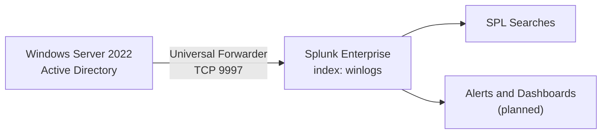

# SOC Home Lab: Windows Server 2022 AD Log Monitoring with Splunk

   

A hands-on SOC home lab that collects logs from a **Windows Server 2022 Active Directory** server into **Splunk Enterprise** using a **Universal Forwarder**, then uses SPL searches to monitor common security events such as failed logons, account creation, group membership changes, process creation and PowerShell activity.

> All activity in this project was generated in an isolated lab environment for learning purposes.

---

## Table of Contents

1. [Project Goals](#project-goals)
2. [Architecture](#architecture)
3. [Lab Environment](#lab-environment)
4. [Log Sources Collected](#log-sources-collected)
5. [Setup Steps](#setup-steps)
6. [Detections and SPL Queries](#detections-and-spl-queries)
7. [Screenshots](#screenshots)
8. [MITRE ATT&CK Mapping](#mitre-attck-mapping)
9. [Lessons Learned](#lessons-learned)
10. [Future Improvements](#future-improvements)
11. [Repository Structure](#repository-structure)
12. [Author](#author)

---

## Project Goals

- Build a working log pipeline from a Windows Server 2022 AD server to a SIEM
- Ingest multiple Windows log sources into a dedicated Splunk index
- Identify security-relevant Windows Event IDs and write SPL searches for them
- Practice the workflow of a SOC analyst: collect, search, investigate, document

---

## Architecture



---

## Lab Environment

| Component | Details |
| --- | --- |
| SIEM | Splunk Enterprise 10.6.1.1 |
| Forwarder | Splunk Universal Forwarder on Windows Server 2022 |
| Monitored host | `WIN-OQK70U8S20J` (`192.168.20.6`) |
| Directory service | Active Directory Domain Services |
| Receiving port | TCP 9997 |
| Index | `winlogs` |
| Volume | About 3,200 events in 24 hours |

---

## Log Sources Collected

Event counts from `index=winlogs | stats count by source` over a 24-hour window:

| Source | Events |
| --- | --- |
| WinEventLog:System | 1,279 |
| WinEventLog:Security | 787 |
| WinEventLog:Microsoft-Windows-PowerShell/Operational | 453 |
| WinEventLog:Microsoft-Windows-Windows Defender/Operational | 318 |
| WinEventLog:Application | 257 |
| WinEventLog:Microsoft-Windows-TerminalServices-LocalSessionManager/Operational | 55 |
| Perfmon:Memory | 41 |
| WinEventLog:Microsoft-Windows-Windows Firewall With Advanced Security/Firewall | 37 |
| Perfmon:CPU | 21 |
| C:\\TestLogs\\test.log (custom file monitor) | 1 |
| **Total** | **3,249** |

### Security Event IDs analysed

| Event ID | Meaning |
| --- | --- |
| 4624 | Successful logon |
| 4625 | Failed logon |
| 4672 | Special privileges assigned to new logon |
| 4688 | New process created |
| 4720 | User account created |
| 4724 | Attempt to reset an account password |
| 4728 | Member added to a security-enabled global group |
| 4104 | PowerShell script block logging (PowerShell/Operational log) |

---

## Setup Steps

### 1. Prepare Splunk Enterprise

1. Create an index: **Settings > Indexes > New Index** and name it `winlogs`.
2. Enable receiving: **Settings > Forwarding and receiving > Configure receiving > New Receiving Port** and enter `9997`.
3. Allow TCP 9997 through the firewall on the Splunk machine.

### 2. Enable extra logging on the Windows Server

- **Command-line in process creation events:** Group Policy > Computer Configuration > Administrative Templates > System > Audit Process Creation > *Include command line in process creation events* > Enabled.
- **PowerShell script block logging:** Group Policy > Administrative Templates > Windows Components > Windows PowerShell > *Turn on PowerShell Script Block Logging* > Enabled.
- **Audit policy:**

```powershell
auditpol /set /subcategory:"Logon" /success:enable /failure:enable
auditpol /set /subcategory:"Process Creation" /success:enable
auditpol /set /subcategory:"User Account Management" /success:enable /failure:enable
auditpol /set /subcategory:"Security Group Management" /success:enable /failure:enable
```

### 3. Install the Universal Forwarder on Windows Server 2022

1. Download the Windows 64-bit Universal Forwarder `.msi` from splunk.com.
2. During installation, choose **Local System** as the service account so the Security log can be read, and set the receiving indexer to `<SPLUNK-IP>:9997`.
3. Silent install alternative:

```powershell
msiexec.exe /i splunkforwarder-<version>-x64-release.msi RECEIVING_INDEXER="<SPLUNK-IP>:9997" USE_LOCAL_SYSTEM=1 AGREETOLICENSE=Yes /quiet
```

### 4. Configure the forwarder

File: `C:\Program Files\SplunkUniversalForwarder\etc\system\local\inputs.conf`

```ini
[WinEventLog://Security]
index = winlogs
disabled = 0

[WinEventLog://System]
index = winlogs
disabled = 0

[WinEventLog://Application]
index = winlogs
disabled = 0

[WinEventLog://Microsoft-Windows-PowerShell/Operational]
index = winlogs
disabled = 0

[WinEventLog://Microsoft-Windows-Windows Defender/Operational]
index = winlogs
disabled = 0

[WinEventLog://Microsoft-Windows-Windows Firewall With Advanced Security/Firewall]
index = winlogs
disabled = 0

[WinEventLog://Microsoft-Windows-TerminalServices-LocalSessionManager/Operational]
index = winlogs
disabled = 0

[perfmon://CPU]
object = Processor
counters = % Processor Time
instances = _Total
interval = 10
index = winlogs
disabled = 0

[perfmon://Memory]
object = Memory
counters = Available MBytes; % Committed Bytes In Use
interval = 10
index = winlogs
disabled = 0

[monitor://C:\TestLogs\test.log]
index = winlogs
disabled = 0
```

File: `C:\Program Files\SplunkUniversalForwarder\etc\system\local\outputs.conf`

```ini
[tcpout]
defaultGroup = default-autolb-group

[tcpout:default-autolb-group]
server = <SPLUNK-IP>:9997
```

Restart the forwarder:

```powershell
Restart-Service SplunkForwarder
```

### 5. Verify the connection

```spl
index=_internal source=*metrics.log group=tcpin_connections
| stats latest(_time) by sourceIp, hostname
```

The forwarder host (`192.168.20.6` / `WIN-OQK70U8S20J`) should appear in the results. Then confirm data is arriving:

```spl
index=winlogs | stats count by source
```

---

## Detections and SPL Queries

### Failed logons (4625)

```spl
index=winlogs source="WinEventLog:Security" EventCode=4625
| table _time ComputerName Account_Name Failure_Reason
```

> Always filter by `source="WinEventLog:Security"`. Event ID 4625 only means "failed logon" in the Security log. Other logs can reuse the same number for unrelated events.

### Failed logons grouped by target account

```spl
index=winlogs source="WinEventLog:Security" EventCode=4625
| eval target_account=mvindex(Account_Name, -1)
| stats count by target_account
| sort - count
```

### Successful logons (4624)

```spl
index=winlogs source="WinEventLog:Security" EventCode=4624
| stats count by Account_Name
```

### Special privileges assigned (4672)

```spl
index=winlogs source="WinEventLog:Security" EventCode=4672
| table _time ComputerName Account_Name
```

### New user account created (4720)

```spl
index=winlogs source="WinEventLog:Security" EventCode=4720
| table _time ComputerName Account_Name Display_Name
```

### Password reset attempt (4724)

```spl
index=winlogs source="WinEventLog:Security" EventCode=4724
| table _time ComputerName Account_Name
```

### User added to a security group (4728)

```spl
index=winlogs source="WinEventLog:Security" EventCode=4728
| table _time ComputerName Account_Name Group_Name
```

### Process creation (4688)

```spl
index=winlogs source="WinEventLog:Security" EventCode=4688
| table _time ComputerName Account_Name Creator_Process_Name
```

### PowerShell script block logging (4104)

```spl
index=winlogs EventCode=4104
| table _time ComputerName Message
```

### Event volume per source

```spl
index=winlogs
| stats count by source
| sort - count
```

### Candidate alert: brute-force pattern (next step)

```spl
index=winlogs source="WinEventLog:Security" EventCode=4625
| eval target_account=mvindex(Account_Name, -1)
| stats count by target_account
| where count >= 5
```

Planned to be saved as a scheduled Splunk alert (for example, every 5 minutes over the last 15 minutes).

---

## Screenshots

### 1. Forwarder connected to Splunk

 The `_internal` metrics search shows the forwarder host `WIN-OQK70U8S20J` (`192.168.20.6`) connected to Splunk.

### 2. Log sources and event counts

 3,249 events in 24 hours across 10 sources in the `winlogs` index.

### 3. Failed logons (4625)

 Failed logon events from the Security log.

### 4. User account created (4720)

 Detection of a newly created user account.

### 5. Group membership change (4728)

 A member added to a security-enabled global group.

### 6. Process creation (4688)

 118 process creation events in a 7-day window.

### 7. PowerShell script block logging (4104)

 475 script block events captured from the PowerShell/Operational log.

---

## MITRE ATT&CK Mapping

Potential technique relevance for the events monitored in this lab:

| Event ID | Activity | Related technique |
| --- | --- | --- |
| 4625 | Repeated failed logons | T1110 Brute Force |
| 4624 / 4672 | Valid logons, privileged logons | T1078 Valid Accounts |
| 4720 | Account created | T1136 Create Account |
| 4724 | Password reset attempt | T1098 Account Manipulation |
| 4728 | Added to security group | T1098 Account Manipulation |
| 4688 | Process creation | T1059 Command and Scripting Interpreter |
| 4104 | PowerShell script blocks | T1059.001 PowerShell |

---

## Lessons Learned

- **Filter by source, not just Event ID.** Event ID 4625 means a failed logon only in the Security log. Searching by number alone can mix in unrelated events from other logs.
- **Timezone differences matter.** The Windows Server logs timestamps in its own timezone (Pacific, -0800), while Splunk displayed times in my browser's timezone. Correlating events during an investigation requires knowing both.
- **Logging has to be enabled deliberately.** Command-line auditing and PowerShell script block logging produce no data until the policies are turned on.
- **The forwarder service account matters.** Reading the Security log requires the Universal Forwarder to run with sufficient privileges (Local System in this lab).
- **Verify the pipeline first.** Checking `index=_internal` for the forwarder connection before searching for data saves a lot of troubleshooting time.

---

## Future Improvements

- [ ] Add **Sysmon** for process, network and file telemetry
- [ ] Save the brute-force search as a **scheduled alert**
- [ ] Build a **dashboard** for logons, failures and account changes over time
- [ ] Forward **Active Directory Directory Service** logs
- [ ] Expand **MITRE ATT&CK** coverage with additional detections

---

## Repository Structure

```
splunk-ad-log-monitoring-lab/
├── README.md
├── configs/
│   ├── inputs.conf
│   └── outputs.conf
├── spl-queries/
│   └── detections.md
├── screenshots/
│   ├── 01-forwarder-connected.png
│   ├── 02-sources-by-count.png
│   ├── 03-failed-logons-4625.png
│   ├── 04-user-created-4720.png
│   ├── 05-group-change-4728.png
│   ├── 06-process-creation-4688.png
│   └── 07-powershell-4104.png
└── docs/
    └── lessons-learned.md
```

---

## Author

**Ranjin R** Cybersecurity student | Aspiring SOC Analyst

- LinkedIn: [linkedin.com/in/ranjinr](https://linkedin.com/in/ranjinr)
- GitHub: [github.com/ranjinr21-debug](https://github.com/ranjinr21-debug)

---

*This project was built for educational purposes in an isolated home lab.*